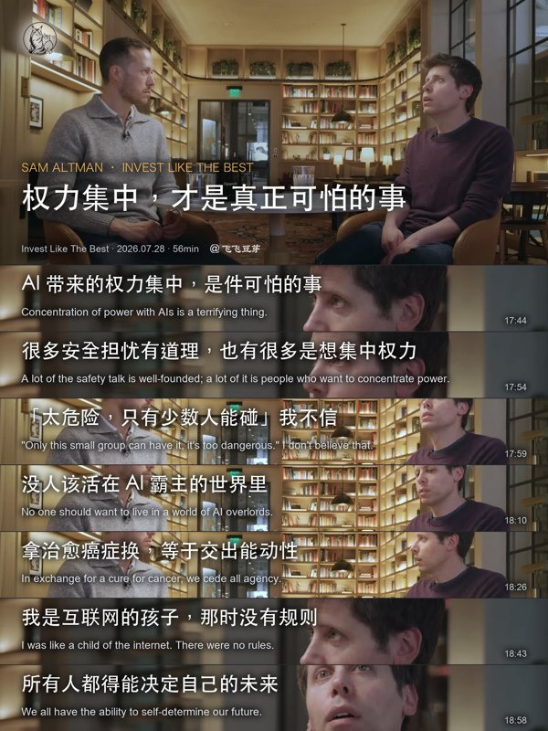

# video-quote-image

把访谈、播客、演讲或纪录片制作成可核验的中文/双语金句长图和小红书发布包。

本仓库的核心不是单一渲染脚本，而是把真实来源、时间码、翻译、人物、选帧、图片、发布文案和 ZIP 绑定到同一版本的交付契约。



## 当前标准

Skill 采用五层标准：

1. 论证结构驱动的选题和选句。
2. 跨平台字体、真实帧和烧录字幕处理明确的版式。
3. 音频英文到中文的四轮逐句校准。
4. 可核验的人物介绍和发布包装。
5. Schema、SHA-256、ZIP 成员和风险红队组成的交付门禁。

完整入口见 [`SKILL.md`](SKILL.md)。它只保留路由和硬约束；详细规则按需放在 `references/`，JSON 契约位于 `schemas/`。

## 最短受支持路径

```bash
uv venv --python 3.11 .venv
uv pip install --python .venv/bin/python -r requirements-tools.txt
.venv/bin/python scripts/doctor.py
```

下载与来源证据：

```bash
.venv/bin/python scripts/download_source.py URL --out-dir PROJECT/source
```

选句文件必须带稳定的 `image.id` 和 `quote_id`：

```bash
.venv/bin/python scripts/locate_quotes.py \
  PROJECT/audit/source_subs.srt PROJECT/audit/quotes.json \
  -o PROJECT/audit/spec.json
```

确认原片没有烧录字幕后渲染：

```bash
.venv/bin/python scripts/render_quote_cards.py PROJECT/source/source.mkv \
  --spec PROJECT/audit/spec.json --out-dir PROJECT/images \
  --render-json PROJECT/audit/render.json \
  --source-subtitle-policy verified-absent \
  --aspect 3:4 --width 1440 --hero-fraction 0.362
```

原片有底部烧录字幕时，应在原尺寸抽查后改用 `--source-subtitle-policy cropped --source-crop-bottom RATIO`。处理状态为 `unknown` 只能作为草稿。

完成四轮校准、人物、选帧和发布包后：

```bash
.venv/bin/python scripts/build_release_manifest.py \
  --root PROJECT --status final --version v1 --zip ../release-v1.zip

.venv/bin/python scripts/preflight.py \
  --root PROJECT --video source/source.mkv --status final --zip ../release-v1.zip
```

只有 preflight 退出 0、ZIP 成员哈希匹配，并且逐张查看过 1440×1920 原图，才能称为 reviewed/final。

## 环境与 Manus

Python 依赖不会安装系统字体或 `ffprobe`。`doctor.py` 会检查 Pillow、imageio-ffmpeg、jsonschema、yt-dlp、ffmpeg/ffprobe、curl、rsync 和跨平台字体。

Manus 等 Linux 镜像如果预装 Noto CJK、FFmpeg 和 yt-dlp，可以直接通过检查；缺依赖时会明确停止，不会再静默生成方框字。完整流水线安装 `requirements-tools.txt`；需要本地 Whisper 时再安装 `requirements-asr.txt`。

ElevenLabs 适配器默认使用 Scribe v2，并要求显式 `--allow-cloud`，因为音频会离开本机。Skill 不硬编码易变的价格和免费额度。

## 测试

```bash
.venv/bin/python -m unittest discover -s tests -v
uvx ruff check scripts tests
```

CI 同时验证 Python 语法、JSON Schema/模板语法、VTT/SRT 时间定位、预检对账和运行环境。

## 同步维护

本机事实源是 `~/.agents/skills/video-quote-image`。仓库的 README、`docs/`、`.github/` 和 `sync.sh` 为仓库专有文件，其余内容由事实源同步。

```bash
./sync.sh --dry-run   # 只显示差异，不写文件、不暂存
./sync.sh "说明"      # 同步、提交并推送 main
```

正式同步要求工作区干净，并且只暂存 Skill 内容，避免把 README 或其他人工修改混入自动提交。
